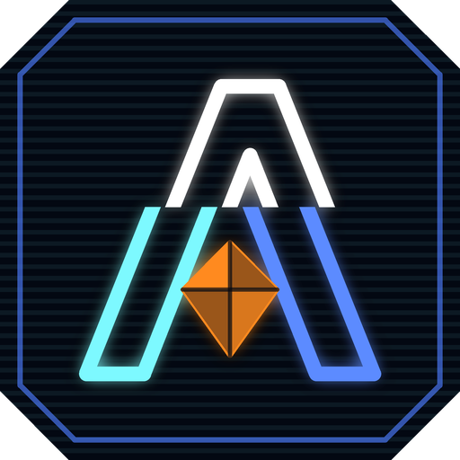

<p align="center">
  
</p>

<h1 align="center">Aria JDR</h1>

<p align="center">
  Un jeu de rôle solo : un LLM local raconte, le code arbitre les règles.
</p>

[](https://github.com/ZedjeK/Aria-JDR/actions/workflows/tests.yml)

Application de jeu de rôle solo : on choisit son univers (fantasy, cyberpunk, post-apo…), et un LLM local fait le maître du jeu sur un socle de règles d100 commun à tous les univers.

Les règles du jeu sont dans [REGLES.md](REGLES.md).

## Avant de commencer

Windows 10 ou 11, 64 bits, sans droits administrateur. Une carte graphique NVIDIA fait tourner le MJ : la seule essayée est une RTX 4080 SUPER (16 Gio), avec Qwen3.8 27B. Le serveur llama et les modèles ne sont pas dans l'exe (plusieurs Go) : voir « L'exe portable ». Le jeu n'ouvre aucune connexion vers Internet : son interface s'ouvre dans ton navigateur, mais elle est servie par ton PC, sur `127.0.0.1:8420`.

## Installation

1. Télécharge `Aria-JDR-<version>.zip` depuis la page des versions.
2. Décompresse d'abord le zip en entier : clic droit, « Extraire tout ». Choisis un dossier stable (pas Téléchargements). Ne lance pas l'exe depuis l'aperçu du zip dans l'Explorateur : Windows n'en extrait que l'exe, sans les fichiers livrés à côté de lui.
3. Lance `Aria-JDR.exe` : l'interface s'ouvre dans ton navigateur par défaut. Relancer l'exe rouvre l'interface déjà ouverte au lieu d'en démarrer une seconde.

L'exe n'est pas signé : Windows peut afficher « Windows a protégé votre ordinateur ». Clique sur « Informations complémentaires », puis sur « Exécuter quand même ». Il n'y a ni installation ni mise à jour automatique : pour changer de version, décompresse le nouveau zip et remplace l'exe ; tes parties restent dans `%USERPROFILE%\.Aria-JDR`.

Tout ce que le jeu écrit (campagnes, profil du MJ, journaux) va dans le dossier `%USERPROFILE%\.Aria-JDR\`, que tu lances l'exe ou les sources. Ce dossier ne se change pas ; le menu Réglages a un raccourci pour l'ouvrir.

## Principe

- **Le code arbitre** : jets de dés, points de vie, Santé mentale, progression. C'est le moteur, dans le dossier `aria/`.
- **Le LLM raconte** : il décrit les scènes, fait parler les personnages et appelle le moteur quand une règle s'applique.
- **Les univers** sont des fichiers JSON dans le dossier `univers/` : réglages, noms des compétences, parcours et armurerie. Le moteur les vérifie au chargement.
- **La bibliothèque** (dossier `bibliotheque/`) range une seule fois tout ce qui peut exister dans une partie : les parcours des 8 genres, les armes, les armures, les modifications, les fabricants, les implants, les véhicules et les drones, les domaines de magie. Chaque entrée dit dans quels genres elle a sa place ; une campagne ne garde que ce qui a droit à son genre et à sa magie. Le moteur vérifie toute la bibliothèque au chargement, avec les règles du jeu.

## Depuis les sources

```bash
python -m venv .venv
.venv\Scripts\python.exe -m pip install -r requirements.txt
```

## Jouer la démo

Une ruelle de Néo-Tokyo : tu joues Kaito, le Netrunner, contre deux gangers. Les dés sont vraiment aléatoires, chaque partie est différente.

```bash
.venv\Scripts\python.exe -m aria.demo
```

La partie est sauvegardée dans `.Aria-JDR\demo_kaito.json`.

## Le MJ : qualifier un modèle sur son PC

Dans l'interface : Réglages › « Qualifier le MJ ». Depuis les sources, en console :

Le MJ tourne avec [le fork PrismML de llama.cpp](https://github.com/PrismML-Eng/llama.cpp), attendu par défaut dans `%USERPROFILE%\Aria-LLM\llama-prism\`, avec les modèles dans `%USERPROFILE%\Aria-LLM\modeles\` (la liste est dans `aria/optimiseur.py`).

```bash
.venv\Scripts\python.exe -m aria.banc
```

Le banc lit la VRAM de la carte graphique, choisit le contexte et le cache qui tiennent, puis fait jouer au modèle 83 situations, dont 23 pièges où il serait tenté de trancher sans les dés, de jouer à la place du joueur, de croire un faux souvenir, de lancer un sort que le personnage ne connaît pas, d'accorder de l'argent et du butin que le moteur n'a pas tirés, ou de décider lui-même d'une réputation, d'un indice ou de l'issue d'une mêlée. Kaito y joue avec son inventaire et son argent : acheter, marchander, revendre, payer un service, accepter une mission, fouiller un adversaire ou une cache, travailler une semaine, emprunter. Onze situations se jouent dans un petit monde vivant, avec ses quartiers et ses factions : changer de quartier, prendre une offre de mission, préparer une mêlée ou s'y battre, trouver un indice, enquêter chez l'antagoniste. Huit autres s'y jouent avec l'aléatoire du monde : créer un PNJ par son rôle et sa menace, compter le temps qu'il fait dehors et pas à l'abri, indiquer un lieu de la carte, faire entrer en scène le tenancier d'un lieu ou le PNJ d'une rencontre de rue, refuser de changer le temps ou d'inventer une armurerie. Le combat à pied, que le code mène pendant que le MJ le raconte, a ses propres situations : déclencher le combat, raconter un round à partir des faits (sans chiffre, sans fait inventé, sans rien décider à la place du joueur), jouer « Parler » et « Autre action » avec de simples jets, ouvrir la poursuite d'une fuite. Le MJ n'a d'office qu'un socle de vingt outils ; les autres sont rangés par famille (combat, poursuite et véhicules, commerce, missions et trame, soins et santé mentale, magie). Le moteur ouvre seul les familles que la situation impose, et le MJ ouvre les autres quand il en a besoin, deux au plus par scène : trois situations vérifient qu'il n'en ouvre pas pour une simple conversation, qu'il en ouvre une troisième quand il le faut, et qu'il ne raconte pas un paiement sans son outil. Les situations de magie se jouent avec Elara, une mage, dans un univers de Fantasy étalon (`univers/fantasy.json`), avec les domaines de l'annexe C des règles. Il garde le plus petit budget de réflexion qui passe : au moins 90 % des situations normales et tous les pièges, chacune réussie deux fois. Le résultat va dans `.Aria-JDR\profil_mj.json`. Si aucun modèle ne passe, il n'y a pas de MJ sur ce PC. `--tous` qualifie tous les modèles présents, pour comparer, et `--budgets 128 256 512` limite les budgets essayés, pour gagner du temps.

Le générateur d'univers a son propre banc, avec le modèle retenu : cinq cadres de référence (Osaka 2091, Arkham 1925, le Mékong en 1968, un royaume médiéval, Lyon en 2061), joués deux fois. Le code vérifie que rien d'anachronique ne reste, que les noms ne sont ni anglais ni fautifs, et que l'univers a de 15 à 30 parcours. Il garde le plus petit budget qui réussit au moins 9 essais sur 10 (`budget_generateur` dans le profil). Le menu « qualifier » enchaîne les deux bancs.

```bash
.venv\Scripts\python.exe -m aria.banc_generateur --budgets 512
```

## Jouer avec le MJ

La même ruelle, mais en texte libre : tu écris ce que fait Kaito, et le MJ retenu par le banc appelle le moteur puis raconte. Chaque jet s'affiche avant la narration, pour que tu voies toujours ce que disent les dés.

```bash
.venv\Scripts\python.exe -m aria.jeu
```

En combat à pied (à mains nues, au couteau, au pistolet, au fusil), c'est le code qui mène : à chaque tour, il joue les ennemis avec une petite IA (un bretteur fonce, un tireur s'abrite et vise ; chacun tient compte de son moral, de son arme et du couvert), et à ton tour il t'offre un menu de boutons : attaquer, viser, recharger, débloquer, changer d'arme, te mettre à couvert, lancer un sort à une cible, stabiliser un blessé, parler, tenter autre chose, fuir, terminer le tour. Les options impossibles sont grisées, avec la raison. Le combat se joue sur une carte en cases hexagonales (REGLES.md 7.11) que le code dessine d'après le lieu choisi par le MJ (ruelle, entrepôt, bar, toit, parking, couloir) : chacun a une position, une arme de mêlée exige le contact, une arme de tir a sa portée en cases, et le couvert vient des obstacles entre le tireur et sa cible. Le menu propose de se déplacer (au contact d'un ennemi, à couvert de lui, loin de lui, près d'un allié) et l'écran donne les positions en mots. Dans l'interface, la carte du combat s'affiche au-dessus du journal : les obstacles, les pions de chaque camp, celui dont c'est le tour, et en cyan les cases que tu peux atteindre ; dans « Se déplacer… », les destinations du menu sont numérotées sur la carte et un clic sur l'une d'elles la choisit. Les deux cartes, celle de la campagne et celle du combat, prennent l'habillage du genre : Néon (Cyberpunk, Science-fiction), Parchemin (Fantasy), Gothique (Dark fantasy, Horreur), État-major (Militaire, Contemporain), Rouille (Post-apo). Les Réglages permettent d'en imposer un. Le MJ ne tire plus les dés des ennemis : il raconte chaque round à partir des faits que le code lui donne, sans chiffre et sans rien décider à ta place. « Parler », « Autre action » et « Fuir » lui rendent la main pour cette action seulement. Dans les Réglages, tu choisis quand il raconte (à chaque round, à la fin seulement, ou jamais), si tu vois les PV exacts des ennemis et si tu choisis ta défense à chaque attaque. Un essai est éteint par défaut : laisser le MJ choisir les actions des ennemis (le code garde toujours une IA de repli). Les combats avec un drone, une arme de zone, un lanceur de sorts ou un véhicule se jouent comme avant, avec le MJ aux commandes : le moteur tient le tour de parole, écrit à chaque fin de round la fiche du combat (`combat.md`) et la donne au MJ pour qu'il raconte avec les vrais PV. Dans les deux cas, quand le combat se termine, ses moments forts et son résultat rejoignent les souvenirs de la campagne (`souvenirs.md`), puis la fiche est effacée.

`etat` affiche ta fiche, ton argent et ton niveau de vie (le coût de la vie est débité tous les 7 jours de jeu, voir REGLES.md 13), `quitter` termine la session : le MJ range la scène en cours dans la mémoire, puis viennent la progression des compétences et la sauvegarde. La partie est aussi sauvegardée après chaque action. Au lancement suivant, la campagne reprend là où tu l'as laissée, et le MJ te rappelle où vous en étiez.

Une nouvelle campagne a un monde qui vit (REGLES.md 14) : une carte de districts et de quartiers tenus par des factions, des mêlées pour leur contrôle, des événements qui tombent sans prévenir, des offres de mission, et une trame avec son antagoniste et son secret. Tu choisis le type de campagne (contrat, courte, standard, longue, sans fin) et l'expérience de ton personnage (débutant, aguerri, vétéran). `carte` montre qui tient quoi et ce que chaque faction pense de toi, `monde` les dernières nouvelles, `pistes` tes indices. Dans l'interface, l'onglet Carte dessine cette carte : un point par quartier, coloré par la faction qui le tient, les districts en halo, un anneau cyan là où tu es, un anneau orange sur les quartiers disputés. Un clic donne la fiche du quartier (qui le tient, son contrôle, ta réputation, les lieux que tu y connais) et « S'y rendre » écrit à ta place « Je me rends à… » dans la partie, pour un quartier voisin du tien : c'est le MJ qui joue le déplacement, avec le temps et les rencontres qui vont avec. Rien ne te presse : la mission principale attend. Une campagne créée avant ce monde se joue comme avant, sans carte.

Dans ce monde, le hasard est tiré par le moteur et non inventé par le MJ (REGLES.md 15) : les noms des PNJ, qui ne sortent pas deux fois dans une campagne ; leurs chiffres, d'après le rôle et la menace que le MJ choisit ; le temps qu'il fait, tiré chaque matin selon le climat et la saison, avec ses effets sur les tests et les tirs dehors ; les lieux de chaque quartier, avec leur enseigne et leur tenancier ; les rencontres de rue, quand tu entres dans un quartier. Le commerce passe par les lieux : une arme s'achète dans une armurerie, des soins dans une clinique, un implant chez un charcudoc ; si le quartier n'en a pas, le jeu t'indique le plus proche. `monde` donne aussi le temps qu'il fait, `carte` les lieux que tu connais. Les tables de rôles, de lieux et de rencontres n'existent pour l'instant que pour le Cyberpunk ; les autres genres ont des tables génériques. Une campagne créée avant cet aléatoire se joue comme avant.

Pour une autre campagne, dans un univers généré depuis la bibliothèque, donne-lui un nom et un genre ; les réglages sont préremplis selon le genre (REGLES.md 1.2). L'univers est écrit une seule fois dans le dossier de la campagne (`univers.json`) et ne change plus ensuite. Une nouvelle campagne commence par la création de ton personnage, guidée : réponds « tout » pour que tout soit proposé d'un coup (les chiffres par le code, le nom et la personnalité par le LLM), ou avance pas à pas en gardant, relançant ou saisissant chaque étape. Vient ensuite l'amorce de la campagne : donne ton idée de départ en une phrase, ou laisse le jeu piocher un plan dans la bibliothèque ; le MJ en tire le passé de ton personnage, le lieu, les gens qu'il connaît et ce qui l'occupe, rangés dans la mémoire de la campagne (REGLES.md 5).

```bash
.venv\Scripts\python.exe -m aria.jeu --campagne osaka --genre Cyberpunk --nom "Osaka 2091" --cadre "Osaka sous la pluie acide" --annee 2091
```

Le MJ adapte l'univers au cadre : tout ce qui apparaît après l'année du cadre est retiré par le code (sans `--annee`, le MJ la déduit du cadre), puis il retire ce qui n'a pas sa place, renomme ce qui jure et ajoute des parcours propres au cadre. `--surprends-moi` lui laisse proposer le nom et le cadre.

Chaque campagne a son dossier, ici `.Aria-JDR\campagnes\neo-tokyo-kaito\`, avec sa sauvegarde, la fiche du combat en cours et sa mémoire, en trois fichiers Markdown que tu peux lire et retoucher :

- `souvenirs.md` : le journal, avec les combats et les scènes terminés ;
- `pnj.md` : les PNJ rencontrés, leur rôle, leur attitude envers Kaito et leur état (un mort reste mort) ;
- `fils.md` : les quêtes, promesses, dettes et menaces, ouvertes puis closes.

Le MJ écrit sa mémoire avec ses outils, et le moteur la vérifie. À chaque requête, il en reçoit un résumé de taille bornée : les fils ouverts, les PNJ connus, les derniers souvenirs en entier et les plus vieux par leur titre. Quand la conversation devient trop longue pour le modèle, les plus vieux échanges sont oubliés, mais pas la mémoire.

## L'exe portable

> Cette version de l'exe ouvre l'interface web, où l'on gère ses campagnes, sa corbeille et ses personnages, où l'on reprend ou commence une campagne et où l'on crée un personnage, avec le MJ de ce PC, qualifié depuis les Réglages. Le menu décrit ici est celui de la console (`python -m aria`, depuis les sources), qui garde aussi la démo sans MJ.

`Aria-JDR.exe` regroupe tout dans un seul fichier, avec un menu :

- **Nouvelle campagne** : son nom, son genre, son cadre (écrit par toi, ou proposé par le MJ) et son ton, puis l'univers, le personnage (créé sur place, ou pris parmi tes personnages prêts pour ce genre) et l'amorce ;
- **Reprendre une campagne** : la liste de tes campagnes, avec leur univers, leurs réglages, le personnage et où il en est. Une campagne supprimée va dans `.Aria-JDR\corbeille\`, sans être effacée ;
- **Personnages** : les personnages que tu prépares à l'avance, hors campagne, pour un genre. Ils sont rangés dans `.Aria-JDR\personnages\` ; Kaito, le Netrunner de la démo, est livré avec le jeu ;
- **Réglages** : le MJ retenu sur ce PC et sa requalification, le dossier des données, la corbeille et la démo sans MJ.

Les options de `aria.jeu` (`--campagne`, `--genre`…) restent là pour qui préfère la ligne de commande. Pas besoin d'installer Python sur le PC qui le lance. Si aucun MJ n'est qualifié sur ce PC, l'exe propose de lancer le banc d'abord.

Le serveur llama et les modèles ne sont pas dans l'exe, car ils pèsent plusieurs Go. L'exe cherche le dossier `Aria-LLM` à côté de lui, puis dans le dossier de l'utilisateur. Les parties, elles, restent dans `.Aria-JDR` : tu peux remplacer l'exe par une nouvelle version sans y toucher.

```
Aria-JDR\
  Aria-JDR.exe
  Aria-LLM\      (facultatif : llama-prism\ et modeles\)
```

Pour le construire toi-même : voir « Compiler soi-même ».

Certains antivirus signalent à tort les exe PyInstaller : c'est un faux positif connu.

`python -m aria` ouvre le même menu depuis les sources.

## Où sont tes données

Tout est dans `%USERPROFILE%\.Aria-JDR`, que tu lances l'exe ou les sources :

- `campagnes\` : une par campagne, avec sa sauvegarde, sa mémoire en Markdown et son univers ;
- `personnages\` : les personnages préparés à l'avance, Kaito compris ;
- `corbeille\` : les campagnes supprimées, qui ne sont pas effacées ;
- `profil_mj.json` : le MJ retenu sur ce PC et le réglage du serveur qui va avec ;
- `banc_*.json`, `banc_generateur.json` : le détail des bancs d'essai ;
- `serveur_*.log` : les journaux du serveur llama ;
- `cache\` : là où l'exe se décompresse pendant qu'il tourne ;
- `demo_kaito.json` : la sauvegarde de la démo ;
- `reglages.json` : les réglages de l'interface (le fond animé) ;
- `journal.json` : les 500 dernières opérations de l'interface ;
- `sauvegardes\` : une copie datée de `reglages.json` avant chaque modification ;
- `secrets\` : le port et le jeton de l'instance en cours, chiffrés pour ton compte Windows, effacés à l'arrêt.

Aucun mot de passe ni clé n'y est gardé. Supprimer ce dossier remet le jeu à neuf (parties comprises : copie d'abord `campagnes\` et `personnages\` si tu y tiens).

## Sécurité

- **Droits** : le jeu se lance sans droits administrateur.
- **Connexions sortantes** : aucune vers Internet. Le jeu écoute sur `127.0.0.1:8420` pour son interface, lance le serveur llama sur ton PC et lui parle sur `127.0.0.1:8080`, rien d'autre. Il lance ton navigateur par défaut pour ouvrir l'interface.
- **Interface locale** : elle ne s'ouvre que par l'appli. Un jeton tiré au hasard à chaque lancement est exigé à chaque requête, et les en-têtes `Host` et `Origin` sont vérifiés : une page web ouverte dans ton navigateur ne peut pas la piloter.
- **Secrets** : le jeu ne garde que le port et le jeton de l'instance en cours, chiffrés par la protection des données de Windows (DPAPI) et effacés à l'arrêt. Cette protection ne joue pas contre un programme lancé sous le même compte Windows.

Pour signaler une faille : voir [SECURITY.md](SECURITY.md).

## Limites à connaître

- **Sans MJ qualifié, l'interface ne démarre aucune partie** : au premier lancement, qualifie-le dans les Réglages (plus d'une heure, avec le serveur du MJ qui occupe la carte graphique). Interrompre la qualification laisse le profil actuel tel quel.
- **Une seule partie à la fois**, et la réponse du MJ arrive d'un bloc, après quelques dizaines de secondes, pas mot à mot. Créer un univers prend plusieurs minutes (environ six à l'essai, avec ton MJ) : la page affiche depuis combien de temps le jeu travaille. Fermer l'onglet n'arrête pas la partie : elle continue côté serveur, et la page la reprend quand on la rouvre. Pour l'arrêter, utilise « Interrompre la partie » ou « Quitter la session ».
- **Pas d'installation par l'exe, pas encore de mise à jour automatique** : on remplace l'exe à la main. Les mises à jour intégrées sont obligatoires pour toute appli Aria ; elles arriveront avec la stack du modèle sur laquelle le jeu est construit, et aucune nouvelle version ne sera publiée avant.
- **L'exe se décompresse dans `cache\`** du dossier de données à chaque lancement (PyInstaller, mode un seul fichier) ; les fichiers sont effacés à la fermeture, mais un arrêt brutal peut y laisser un dossier `_MEI…` que tu peux supprimer.
- **Un seul matériel essayé, un seul modèle qualifié** : une RTX 4080 SUPER, Qwen3.8 27B (Gemma 4 26B tourne mais n'a pas passé le banc). Le banc mesure, il ne garantit pas : une situation peut réussir une fois et échouer la suivante.
- **Le MJ est un LLM** : le moteur tire les dés et tient les chiffres, mais la narration peut se tromper ou s'écarter de la scène.
- **Le combat mené par le code est jeune** : l'IA des ennemis est réglée par un simulateur (deux voyous contre un débutant, sur la carte d'une ruelle : environ sept victoires sur dix, en quatre rounds) et le récit du MJ est vérifié par le banc, mais peu de combats ont été joués en entier. Les ennemis choisis par le MJ restent un essai éteint par défaut : le banc du plan (plans valides, durée, respect des caractères) est concluant, le jugement sur des combats joués reste à faire.
- **Aucune partie longue n'a été mesurée** : les mesures viennent du banc, pas de campagnes jouées.

Mises à jour : l'empreinte SHA-256 vérifie que le téléchargement est intact, pas d'où il vient. La provenance repose sur le compte GitHub de l'auteur, sur les releases immuables (une version publiée ne change plus, à condition que ce réglage soit activé sur le dépôt) et sur l'attestation jointe à chaque zip. Si le compte de l'auteur était compromis, une version piégée pourrait quand même être proposée.

Projet personnel, sans audit de sécurité indépendant.

## Provenance des composants

L'exe embarque l'interpréteur Python et ses bibliothèques natives, le chargeur de PyInstaller, FastAPI, uvicorn et leurs dépendances, et les polices Space Grotesk et IBM Plex Mono : le détail est dans [LICENCES-TIERS.txt](LICENCES-TIERS.txt). Le serveur llama et les modèles, que tu télécharges toi-même, ont leurs propres licences : lis-les avant de les utiliser.

## Compiler soi-même

Il faut Python 3.11 ou plus. Une fois, depuis la racine du dépôt :

```powershell
python -m venv .venv
.venv\Scripts\python.exe -m pip install -r requirements.txt
```

Puis :

```powershell
.uild.ps1
```

L'exe est dans `.work\sortie\Aria-JDR.exe`. `.	ools\empaqueter.ps1` en fait le zip de la version et son empreinte dans `.work
elease\`. La reproductibilité à l'octet n'a pas été vérifiée : pour une version publiée, compare avec l'attestation (`gh attestation verify <zip> --repo ZedjeK/Aria-JDR`).

## Structure

```
aria/           le moteur, le MJ, la table, les bancs ; aria/prompts/ : les prompts du MJ
appli/          l'interface web locale : serveur FastAPI, données, coffre, instance unique ; appli/statique/ : la page
univers/        les univers en JSON
bibliotheque/   parcours, armes, armures, implants, véhicules, magie
tests/          les tests (pytest)
tools/          version, tests, empaquetage, vérification de release
docs/           la fiche projet (FICHE.md) et les notes de version
REGLES.md       le livre de règles
build.ps1       construit l'exe portable dans .work\sortie```

## Lancer les tests

```powershell
.	ools	ester.ps1
```

## Licence

Code et règles sous licence [MIT](LICENSE).
